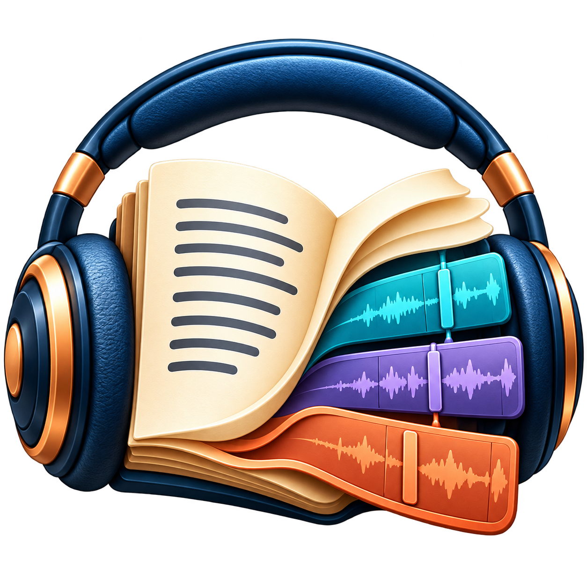

# Podcast Studio

**Create, record and edit podcasts on Windows.** Published by CyberFirePulse.

[Lees dit in het Nederlands](README.nl.md)

## Download

**Version 1.48.1 · Windows 10/11, 64-bit**

[Download the Windows installer](https://github.com/cyberfirepulse/podcaststudio/releases/download/v1.48.1/PodcastStudio_1_48_Setup.exe) · [All releases](https://github.com/cyberfirepulse/podcaststudio/releases)

Run the installer and choose Dutch or English. Windows may show the publisher as unverified because this installer is not digitally signed.

This repository provides documentation, license texts and releases. The application source code is not published here.

## Features

- Text editor, preparation wizard and pronunciation dictionary.
- Piper offline speech, optional Edge online speech, and support for a separately installed custom-voice environment.
- Narrator and quotation roles with separate voice and pace settings.
- Live recording and import/transcription workflows using separately installed components.
- Multitrack editing with move, split, copy, delete, volume automation, eight-band EQ and room effects.
- Audio preview, MP3 export, artwork and episode metadata.
- Project saving, Save as, recent projects, recovery and relinking missing files.
- Dutch and English interface and help.

Available production features depend on your license edition and installed components. A voice model or custom-voice environment is not included in the installer.

## First start

1. Create a new project or open an existing project.
2. Import or type your script and choose your speech engine and voice.
3. If prompted, install FFmpeg and FFprobe with **Audio tools: install / check**. They are downloaded only after you choose to proceed. The download is approximately 110 MB and is checked against the provider's SHA-256 checksum.
4. Listen to a short preview before generating a complete podcast.
5. Save your project and export your MP3.

The app can reuse existing FFmpeg and FFprobe on the search path. Local audio editing and Piper can work offline after the necessary components and models are installed. Edge TTS needs internet access and sends the text to its speech service. Custom voice and transcription require their own models and environment.

## Documentation

- [English manual](docs/manual.en.md)
- [Nederlandse handleiding](docs/manual.nl.md)
- [Privacy and online services](docs/privacy.md)
- [Support and reporting problems](SUPPORT.md)
- [Changes in 1.48.1](CHANGELOG.md)

## Licensing

Podcast Studio is provided under its [software license agreement](legal/License_en.txt) ([Nederlands](legal/License_nl.txt)). No open-source license for the application is granted by this repository. External components and voice models retain their own licenses and notices.

## Contact

**CyberFirePulse** · [cyberfirepulse@gmail.com](mailto:cyberfirepulse@gmail.com)

Do not attach personal voice recordings, private scripts or license keys to public issues.
