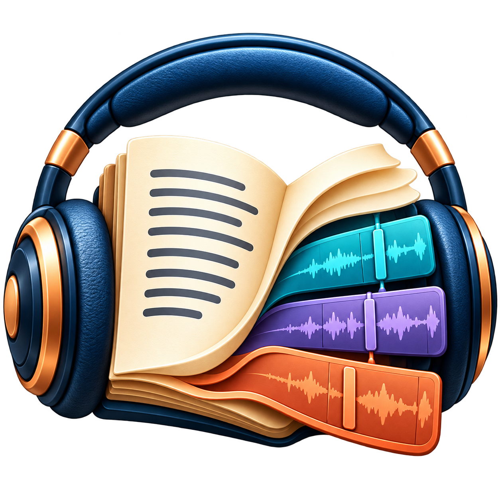

# Podcast Studio

**Podcasts maken, opnemen en bewerken op Windows.** Uitgegeven door CyberFirePulse.

[Read this in English](README.md)

## Downloaden

**Versie 1.48.1 · Windows 10/11, 64-bit**

[Download de Windows-installer](https://github.com/cyberfirepulse/podcaststudio/releases/download/v1.48.1/PodcastStudio_1_48_Setup.exe) · [Alle versies](https://github.com/cyberfirepulse/podcaststudio/releases)

Start de installer en kies Nederlands of Engels. Windows kan een onbekende uitgever melden, omdat de installer niet digitaal is ondertekend.

Deze repository bevat documentatie, licentieteksten en downloads. De broncode van de toepassing wordt hier niet gepubliceerd.

## Mogelijkheden

- Teksteditor, tekstvoorbereidingswizard en uitspraakwoordenboek.
- Piper voor offline spraak, optioneel Edge voor online spraak en ondersteuning voor een afzonderlijk geïnstalleerde eigen-stemomgeving.
- Een hoofdverteller en citaatstem met apart instelbare stem en tempo.
- Rechtstreeks opnemen en bestaande opnamen importeren/transcriberen met afzonderlijk geïnstalleerde onderdelen.
- Meersporenbewerking met verplaatsen, splitsen, kopiëren, verwijderen, volumelijnen, achtbands-EQ en ruimte-effecten.
- Audiopreview, MP3-export, hoesafbeelding en afleveringsgegevens.
- Projecten opslaan, Opslaan als, recente projecten, herstel en ontbrekende bestanden opnieuw aanwijzen.
- Nederlandse en Engelse interface en hulp.

Welke productieopties beschikbaar zijn, hangt af van je licentie-editie en de geïnstalleerde onderdelen. Stemmodellen en een eigen-stemomgeving zitten niet in de installer.

## Eerste gebruik

1. Start een nieuw project of open een bestaand project.
2. Importeer of typ je tekst en kies een spraakengine en stem.
3. Ontbreken FFmpeg en FFprobe? Gebruik **Audioprogramma’s: installeren / controleren**. Downloaden begint pas na jouw keuze. De download is ongeveer 110 MB en wordt gecontroleerd met de SHA-256-controle van de aanbieder.
4. Beluister een kort voorbeeld voordat je de hele podcast genereert.
5. Sla je project op en exporteer je MP3.

Bestaande FFmpeg en FFprobe op het zoekpad kunnen worden hergebruikt. Lokale audiobewerking en Piper werken offline nadat de benodigde onderdelen en modellen zijn geïnstalleerd. Edge TTS vereist internet en verstuurt de voor te lezen tekst naar de spraakdienst. Eigen stem en transcriptie vereisen hun eigen modellen en omgeving.

## Uitleg

- [Nederlandse handleiding](docs/manual.nl.md)
- [English manual](docs/manual.en.md)
- [Privacy en online diensten](docs/privacy.md)
- [Ondersteuning en problemen melden](SUPPORT.md)
- [Wijzigingen in 1.48.1](CHANGELOG.md)

## Licentie

Voor Podcast Studio gelden de [gebruiksvoorwaarden](legal/License_nl.txt) ([English](legal/License_en.txt)). Deze repository verleent geen opensourcelicentie voor de toepassing. Externe onderdelen en stemmodellen behouden hun eigen licenties en vermeldingen.

## Contact

**CyberFirePulse** · [cyberfirepulse@gmail.com](mailto:cyberfirepulse@gmail.com)

Plaats geen persoonlijke stemopnamen, privéteksten of licentiesleutels in openbare meldingen.
